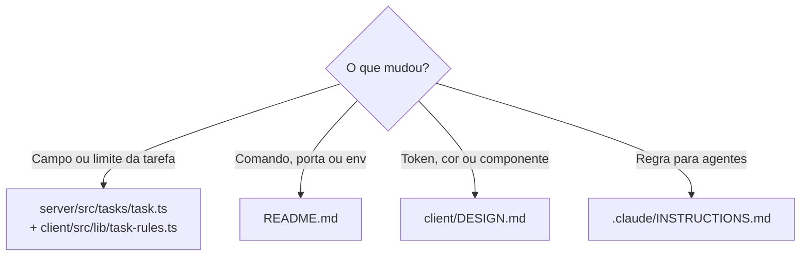

# Instruções — ArtefactAI

Monorepo de tarefas (CRUD): `server/` é o backend tRPC 11 em Node 26, `client/` é o frontend Next.js 16, `.claude/` tem as ferramentas globais.

## Leia antes de agir

| Situação | Documento |
|---|---|
| Como rodar, variáveis de ambiente, decisões de arquitetura | `README.md` |
| Cor, tipografia, componente visual | `client/DESIGN.md` |
| API do Next.js 16 (difere do que você conhece) | `client/AGENTS.md` → `node_modules/next/dist/docs/` |
| Contrato da tarefa e validação | `server/src/tasks/task.ts` |

## O que atualizar



Documentação entra no mesmo commit que torna a mudança verdadeira.

## Comandos (na raiz)

```bash
npm install          # instala os dois workspaces
npm run dev          # tRPC em :4000 + Next em :3000 (SEED_TASKS=30 para dados de exemplo)
npm test             # Vitest em server e client
npm run lint         # ESLint em ambos
npm run typecheck    # tsc --noEmit em ambos
npm run build        # build de produção do client
```

## Regras duras

1. **O client importa o server só com `import type` de `@artefactai/server`** — import de valor puxa `@trpc/server` e `zod` do backend para o bundle do navegador, e o pacote exporta `.ts` cru que o Next não transpila.
2. **No `server/`, imports relativos usam a extensão `.ts` e só sintaxe apagável** (sem `enum`, `namespace` ou parameter properties) — o Node roda TS por type stripping e o processo não sobe.
3. **Limite de validação muda em `server/src/tasks/task.ts` e `client/src/lib/task-rules.ts` no mesmo commit** — senão o form aceita o que o servidor rejeita.
4. **Constante usada por server component não fica em arquivo `"use client"`** — chega como referência, não como valor.
5. **Ferramentas, hooks e config de agente ficam no `.claude/` da raiz**, nunca dentro de `client/` ou `server/` — cada pasta é um domínio, o `.claude/` é global.
6. **Complexidade ciclomática ≤ 10 por função** — o hook Stop (`.claude/hooks/quality-gate.ps1`) bloqueia o fim do turno.
7. **Commits em inglês, Conventional Commits com escopo (`feat(server):`, `fix(client):`), assunto ≤ 100 caracteres, sem trailer `Co-Authored-By`** — é o padrão do histórico; commit fora dele é refeito.

## Trabalho concluído significa

- [ ] `npm test`, `npm run lint` e `npm run typecheck` limpos
- [ ] `npm run build` limpo, se o `client/` mudou
- [ ] README atualizado se comando, porta ou env mudou

## Não toque

- `package-lock.json` à mão — rode `npm install` na raiz
- `client/AGENTS.md` e `client/next-env.d.ts` — gerados pelo Next a cada `next dev`
- `.next/`, `reports/`, `generated-tests/prompts/`, `.claude/.quality-gate/` — saída de ferramentas
